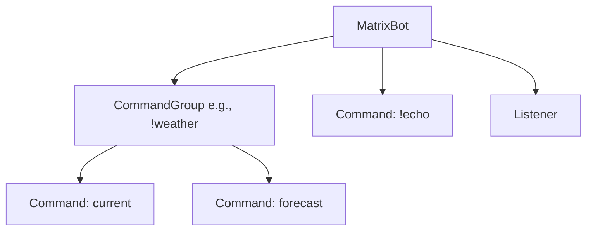

# Architecture

The SDK is organized hierarchically. You instantiate a `MatrixBot`, attach `CommandGroup`s or `Listener`s, and mount `Command`s.

- **Commands** (`bot.command`, `bot.group`): Triggered by specific text prefixes.
- **Listeners** (`bot.on.*`): Triggered by Matrix events, timers, or webhooks.
